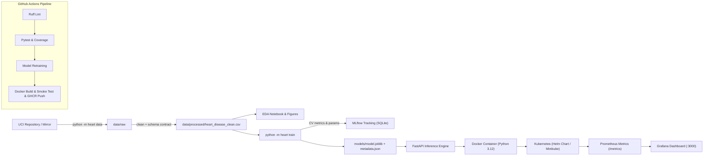

# Heart Disease Risk Prediction - End-to-End MLOps Pipeline

[](https://github.com/ckdeena-bits/mlops-heart-disease/actions)


> **MLOps Experimental Learning Assignment 01 (AIMLCZG523)**  
> **Author:** Deenadayalan C K  
> **Student ID:** 2025AE05402  
> **Dataset:** Heart Disease UCI (Cleveland Clinic Foundation)  
> **Repository:** [github.com/ckdeena-bits/mlops-heart-disease](https://github.com/ckdeena-bits/mlops-heart-disease)

---

## 1. Project Overview & Architecture

This repository delivers a production-grade, automated, and reproducible Machine Learning Operations (MLOps) pipeline for heart disease risk classification. It encapsulates end-to-end best practices:

* **Data Governance & Validation:** Automated ingestion, cleaning, and schema contract validation.
* **Model Experimentation & Tracking:** Stratified 5-Fold Cross-Validation, hyperparameter tuning (`RandomizedSearchCV`), and experiment tracking via **MLflow**.
* **Model Packaging & Versioning:** Champion model bundled with its preprocessing transformer pipeline, metadata, and quality gates (`ROC-AUC >= 0.80`).
* **Production Serving:** **FastAPI** web service providing `/predict`, `/predict/batch`, `/health`, `/model-info`, and `/metrics` with structured JSON telemetry and correlation IDs.
* **CI/CD Automation:** **GitHub Actions** multi-stage pipeline executing Ruff linting, Pytest test suites with coverage, automated retraining, and container publishing to GHCR.
* **Containerization & Orchestration:** Multi-stage non-root **Docker** container and production **Kubernetes** Helm chart with HPA, Ingress, and health probes.
* **Observability:** **Prometheus** metrics scraping and a pre-configured **Grafana** monitoring dashboard.



---

## 2. Repository Layout

```
mlops-heart-disease/
├── .github/workflows/ci.yml       # Multi-stage GitHub Actions CI/CD workflow
├── api/                           # FastAPI serving and Prometheus instrumentation
│   ├── main.py                    # API entrypoint, routes, and logging middleware
│   ├── schemas.py                 # Pydantic data contracts and schemas
│   └── monitoring.py              # Custom Prometheus telemetry metrics
├── data/
│   ├── raw/                       # Original committed Cleveland dataset
│   └── processed/                 # Cleaned, validated dataset
├── docs/                          # Runbooks and presentation scripts
│   ├── vm_runbook.md              # Rocky Linux 9.5 VM deployment instructions
│   ├── video_script.md            # Video walkthrough timeline and script
│   └── implementation_plan.md     # Engineering blueprint & specifications
├── helm/heart-api/                # Production Helm chart (Deployment, Service, HPA, Ingress)
├── k8s/                           # Plain rendered Kubernetes manifests
├── models/                        # Serialized champion model.joblib & metadata.json
├── monitoring/                    # Observability provisioning
│   ├── prometheus.yml             # Scrape configuration
│   └── grafana/provisioning/      # Pre-configured Grafana datasource & dashboard
├── notebooks/                     # Jupyter notebooks (01_eda, 02_training, 03_inference)
├── reports/                       # Generated figures and assignment report
│   ├── figures/                   # Confusion matrices, ROC curves, EDA plots
│   └── MLOps_Assignment1_Report.docx  # Final comprehensive 10-page report
├── screenshots/                   # Verification logs & terminal execution evidence
├── src/heart/                     # Core reusable ML package
│   ├── __main__.py                # CLI runner (python -m heart <cmd>)
│   ├── config.py                  # YAML configuration loader
│   ├── data.py                    # Data ingestion, cleaning, and preprocessing
│   ├── validation.py              # In-house schema data contracts
│   ├── features.py                # scikit-learn ColumnTransformer pipeline
│   ├── train.py                   # Hyperparameter tuning, CV & MLflow logging
│   ├── evaluate.py                # Metric computation and plot generation
│   └── predict.py                 # Risk stratification inference engine
├── tests/                         # Pytest automated test suite
├── Dockerfile                     # Multi-stage, non-root production container
├── docker-compose.yml             # One-command local stack (API + Prometheus + Grafana)
├── Makefile                       # Linux/macOS task automation
├── tasks.ps1                      # Windows PowerShell task automation
├── pyproject.toml                 # Package definition and build configuration
├── requirements.txt               # Production runtime dependencies
└── requirements-dev.txt           # Development, testing, and CI dependencies
```

---

## 3. Quickstart Guide (Local Setup)

### Prerequisites
* Python 3.12 (or Python >= 3.10)
* Git, Docker Desktop or Docker CE, Minikube, and Helm 3/4

### 1. Clone & Set Up Virtual Environment
```bash
git clone https://github.com/ckdeena-bits/mlops-heart-disease.git
cd mlops-heart-disease

python3 -m venv .venv
source .venv/bin/activate       # On Windows: .venv\Scripts\activate

pip install --upgrade pip
pip install -r requirements-dev.txt
pip install -e .
```

### 2. Run Data Ingestion, Training & Pytest
```bash
# Data ingestion and schema validation
python -m heart data

# Train models with 5-fold CV and MLflow tracking
python -m heart train

# Run automated tests and code coverage
pytest --cov=heart --cov=api --cov-report=term-missing
```

### 3. Launch Local Model Serving API
```bash
uvicorn api.main:app --host 0.0.0.0 --port 8000 --reload
# Interactive API documentation: http://localhost:8000/docs
```

---

## 4. Model Evaluation & Benchmark Results

Both candidate models were evaluated with Stratified 5-Fold Cross-Validation on the training split, and validated on the 20% holdout test set:

| Model | CV ROC-AUC | Test Accuracy | Test Precision | Test Recall | Test ROC-AUC | Status |
|---|---|---|---|---|---|---|
| **Logistic Regression (L2)** | **0.9025** | **88.52%** | **83.87%** | **92.86%** | **0.9665** | **Champion Model** |
| **Random Forest Classifier** | **0.9020** | **86.89%** | **83.33%** | **89.29%** | **0.9405** | Baseline |

* **Champion Rationale:** Logistic Regression achieved superior test generalization (ROC-AUC `0.9665`) and outstanding clinical sensitivity (Recall `92.86%`), essential for minimizing false negatives in clinical cardiac screening.
* **Quality Gate:** Both models comfortably satisfied the automated production quality gate (`ROC-AUC >= 0.80`).

---

## 5. Experiment Tracking with MLflow

MLflow runs are logged to an embedded SQLite database (`sqlite:///mlruns/mlflow.db`). To launch the MLflow UI:
```bash
mlflow ui --backend-store-uri sqlite:///mlruns/mlflow.db --port 5000
```
Open `http://localhost:5000` to review:
1. Logged parameters (regularization parameters, solver choices, tree depths).
2. 5-Fold cross-validation metrics across all trials.
3. Confusion matrix figures and ROC curve artifact plots.
4. Serialized pipeline models with input schema signatures.

---

## 6. Local Monitoring Stack (Docker Compose)

Launch the API alongside Prometheus and Grafana with a single command:
```bash
docker compose up -d
```
Services available:
* **FastAPI Service:** `http://localhost:8000` (Swagger UI at `/docs`)
* **Prometheus Dashboard:** `http://localhost:9090`
* **Grafana Telemetry:** `http://localhost:3000` (Default credentials: `admin` / `admin`)

Test the running API:
```bash
curl -X POST http://localhost:8000/predict \
  -H "Content-Type: application/json" \
  -d '{"age":63,"sex":1,"cp":1,"trestbps":145,"chol":233,"fbs":1,"restecg":2,"thalach":150,"exang":0,"oldpeak":2.3,"slope":3,"ca":0,"thal":6}'
```

To shut down:
```bash
docker compose down
```

---

## 7. Kubernetes Deployment with Helm & Minikube

Deploy the containerized service to Minikube using the production Helm chart:

```bash
# 1. Start Minikube & load image
minikube start --driver=docker
docker build -t heart-disease-api:local .
minikube image load heart-disease-api:local

# 2. Deploy Helm release
helm upgrade --install heart-api ./helm/heart-api --set image.pullPolicy=Never

# 3. Verify Kubernetes resources
kubectl get pods
kubectl get svc
kubectl get hpa

# 4. Access endpoint via Port-Forward
kubectl port-forward svc/heart-api 8080:80 &
curl http://localhost:8080/health
```

To uninstall:
```bash
helm uninstall heart-api
```

---

## 8. Continuous Integration & Deployment (CI/CD)

The GitHub Actions workflow (`.github/workflows/ci.yml`) triggers on pushes to `main`:
1. **Lint & Test:** Ruff linting + Pytest with strict coverage reports.
2. **Train & Track:** Model retraining from clean setup with artifact archiving.
3. **Containerize & Publish:** Multi-stage Docker build, container health smoke testing, and publishing to GitHub Container Registry (`ghcr.io/ckdeena-bits/mlops-heart-disease`).

---

## 9. Academic Integrity & Originality

* Custom, in-house schema contract validation in `src/heart/validation.py`.
* Three-tier risk stratification categorization (`Low Risk`, `Moderate Risk`, `High Risk`) augmenting probability scores.
* Structured JSON logging middleware injecting request correlation IDs (`X-Request-ID`).
* Production quality gate assertion integrated into both automated training and test suites.
